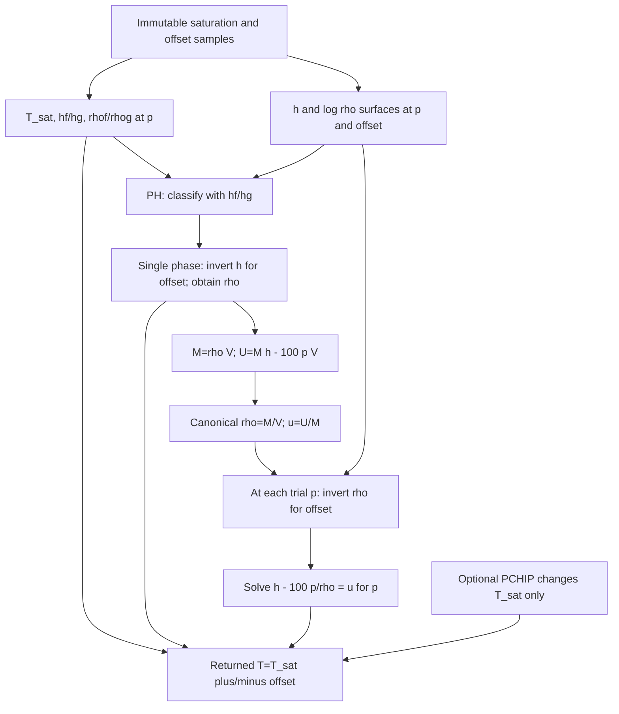

# Joint thermodynamic property consistency investigation

**Diagnostic-only investigation completed. No property correction implemented.**
The approximately 0.033 bar liquid pressure discrepancy comes predominantly from
the existing interpolated **enthalpy/density surface**, amplified by compressed-
liquid state recovery. It is not primarily saturation-temperature bias, inversion
precision, integration error, a units/reference mistake or a five/nine volume
change. The accepted A2 five-section source reproduces the short trajectory
exactly. PCHIP fixes a useful temperature approximation while leaving this
constitutive pressure error and other consistency limitations unresolved.

Plain language: small errors in liquid density and enthalpy are partly cancelling
each other. Liquid pressure is very sensitive to those small errors when mass,
energy and volume are fixed. Improving temperature alone can improve heat flow
without fixing pressure, and can remove a cancellation that previously made a
different quantity appear more accurate. Accurate individual values also do not
guarantee physically correct derivatives between table samples.

Repository `cdehek/Ammonia-sim`, branch `experimental/dx-fv-stage-3`, HEAD
`be9eb35a4ddf5098e685182f8104685127c6a6ee`. All **201 pre-existing files**,
including the uncommitted Stage 2B/PCHIP implementations, frozen data/references
and prior reports, are byte-for-byte unchanged. No existing file modification,
commit, push, default promotion, tolerance change or full qualification matrix.

## Existing property pathways

The immutable table has 241 log-pressure samples from nominal 0.3 to 35 bar,
31 liquid subcooling offsets in 1 K increments, and 126 vapor superheat offsets
in 2 K increments. Rows hold h, s and rho; saturation rows also hold T, hf/hg,
sf/sg and rhof/rhog. `tools/generate_properties.py`, read but never executed,
uses CoolProp 7.2.0 HEOS ammonia, rounds T to eight decimal places and h/s/rho
to seven. There is no `set_reference_state` call. Single-phase samples were
generated at the true EOS saturation temperature plus/minus the declared offset.
Thus this is a curvilinear grid in physical pressure/temperature, not a rectangular
absolute-PT grid. Missing cold-liquid nodes remain unsupported.



Saturation T/h/s are linear in log(p), and densities logarithmic. Branch h/s
are bilinear in log(p)/offset; log(rho) is bilinear. Liquid PH finds its offset
by 38 bisections of the h surface, then evaluates density at that offset. The
target h is retained. Saturation/phase classification uses hf/hg, not temperature.

M/U/V recovery independently finds an offset from density at each trial p using
32 bisections, then evaluates h and `u=h−100*p/rho`. A bounded warm-start pressure
iteration, followed where necessary by the existing bracket/bisection fallback,
uses the original 1e-7 kJ/kg energy criterion. PCHIP shifts the returned saturation
temperature consistently in PH/PT/PX/DU/MVU; **h, rho, u and the pressure recovery
equation are unchanged at fixed PH or M/U/V**. Therefore temperature-only PCHIP
cannot directly repair a same-state canonical pressure discrepancy.

## Exact state definition, units and pressure decomposition

The reproduced sealed diagnostic starts at p=32.65314902038559 bar,
h=686.779725665 kJ/kg, uniform liquid in the unchanged 0.003 m³ evaporator,
with tube/fin/air at 343.42777804386204 K and zero external air load. It runs
0.1 s. This is the previous diagnostic, not a new qualified operating fixture.
Original and PCHIP start with identical M/U/V and thermal energies.

Initial canonical density is 527.776812296635 kg/m³ and specific internal energy
680.592801901090 kJ/kg. Direct CoolProp **D/U recovery at exactly these coordinates**
returns p=32.630316866084 bar, T=69.276689968616 °C,
h=686.775399564687 kJ/kg. The initial pressure error is already
**+0.022832154301 bar**, before a timestep is taken. A fixed-PH comparison instead
holds p/h equal by definition and measures density/T/u errors; it cannot itself
measure a pressure error. These two comparisons must not be conflated.

At 0.1 s, the original five-section table state is approximately
p=32.804737384602 bar, h=686.845872427996 kJ/kg. The independent EOS trajectory
is p=32.772187313599 bar, h=686.839728506037 kJ/kg. Their pressure difference
is **+0.032550071002 bar = 3.255007100 kPa**. The existing direct-EOS budget is
1e-4 bar = 10 Pa. Both property paths fail that pressure budget in this additional
liquid diagnostic; that is not hidden by calling it a supported/qualified fixture.

For each saved JS inventory, a mathematical comparator exactly inverts the
**original** bilinear h/log-density surface, and direct EOS recovers the same
rho/u. No alternative inversion or property value enters a JS integration.
The exact signed decomposition is

`p_JS − p_EOStrajectory = (p_JS − p_exactTable) + (p_exactTable − p_EOSsameMU) + (p_EOSsameMU − p_EOStrajectory)`.

| Case, at 0.1 s | Native inversion | Constitutive surface | Evolution contribution | Total, bar |
| --- | ---: | ---: | ---: | ---: |
| Five original | -6.84e-11 | +0.032638925415 | -0.000088854344 | **+0.032550071002** |
| Five PCHIP | -9.95e-10 | +0.032640435474 | -0.000018447517 | **+0.032621986962** |

The nine-section totals reproduce +0.032550008448 / +0.032622005917 bar;
the same decomposition is recorded for every sampled point on both meshes.
Evolution contribution includes heat-transfer/property and integration effects;
it is **not** asserted pure temporal truncation error. PCHIP reduces it because
its heat transfer is closer to the independent trajectory. Removing that small
beneficial cancellation slightly worsens total pressure error despite improved
temperature and heat input.

At the final original state, EOS internal energy evaluated at the table pressure
and the same density differs from stored u by approximately **0.008615256 kJ/kg**.
The EOS isochoric derivative is approximately **0.263957 kJ/(kg bar)**. Their ratio
predicts the approximately 0.032639 bar constitutive pressure shift. This is about
86,000 times the native 1e-7 kJ/kg inversion stopping criterion. Native-versus-
exact-table pressure differences stay below **1.086e-9 bar** in this probe.
Tighter inversion is not a remedy for the measured 0.033 bar error.

Checks explicitly verify `h−u=100*p/rho`: p is absolute bar, M kg, V m³,
U kJ, and CoolProp receives p×1e5 Pa and u×1000 J/kg. The pressure-work sign
and energy-reference convention agree. Tested frozen knot h/rho values reproduce
EOS within their ±5e-8 rounding intervals, and T within ±5e-9 K. Comparing actual
cell V to 0.003/N produces no resolved pressure difference in these replays.
No volume multiplication, energy offset, pressure-unit conversion or reference-
comparison convention explains the discrepancy.

## Which fields cause the liquid error?

At the initial reported PH point, the interpolated saturation temperature error
is +0.537834 mK, and saturated-liquid enthalpy error is +0.004899007 kJ/kg.
The inferred subcooling offset is approximately 0.100000 K, while true EOS at
the same PH gives 0.098859 K. Its **1.140948 mK** offset error separates into:

| Offset error contribution | Magnitude |
| --- | ---: |
| Saturated-liquid enthalpy anchor | +0.900471 mK, approximately 79% |
| Remaining liquid h-surface/secant shape | +0.240477 mK, approximately 21% |

Hence original PH temperature error is approximately
`+0.537834 − 1.140948 = -0.603114 mK`.
PCHIP reduces the saturation-temperature error to about 6 nK at this point,
exposing approximately -1.140942 mK of PH error. This is not a bad PH search:
native PH differs from the algebraic inverse by approximately 5.5e-11 K here.

The associated density discrepancy separates exactly:

| Fixed-PH density contribution | kg/m³ |
| --- | ---: |
| Saturated-density anchor, propagated to the true offset | -0.003231276 |
| Remaining log-density surface shape at the true offset | -0.001501108 |
| Wrong offset caused by the h surface | +0.002396066 |
| PH inversion precision | approximately -1.15e-10 |
| Net | approximately **-0.002336318**, or **-4.4267 ppm** |

The h-surface error partially cancels the density-surface error. Static diagnostic
component comparisons at fixed PH illustrate why isolated corrections are risky:

| Diagnostic density construction | EOS recovered p, bar | Input p minus EOS p, bar |
| --- | ---: | ---: |
| Original h offset and original density surface | 32.630317 | +0.022832 |
| Only true EOS offset, original density surface | 32.606902 | +0.046247 |
| Only EOS density surface, original h offset | 32.676716 | -0.023567 |
| Both true EOS offset and density | 32.653149 | approximately zero |

These are static component attributions, not implemented correction paths; their
implied diagnostic inventories are never substituted into accepted states.
Improving one field does **not necessarily** worsen another everywhere, but at
this point either isolated h- or density-surface change removes a cancellation.
Temperature-only improvement leaves pressure recovery untouched at fixed PH/MU.

## Domain checks and derivative consistency

A focused set makes 138 property requests over 0.3–35 bar: liquid offsets
0.1/0.5/1/5/15/30 K where physically supported, saturated quality 0/0.5/1,
vapor superheat 5/40/150 K, and the saved liquid trajectory points. Original/PCHIP
non-temperature PH/MUV fields match exactly. A separate 4,080-observation
saturation scan covers all intervals with 17 points per interval:

| Saturation-T error | Original | PCHIP |
| --- | ---: | ---: |
| Maximum | 546.053 µK | 0.948086 µK |
| RMS | 222.748 µK | 0.051183 µK |

For the 124 completed joint comparisons, representative liquid PH maximum T
error is 1.030232→1.568060 mK; vapor 8.862749→8.324921 mK; saturated-endpoint PH
1.487317→0.949489 mK. These are representative-set maxima, not global bounds.
Small saturation-PQ error does not guarantee small endpoint-PH error because
unchanged hf/hg interpolation can classify the true EOS endpoint just inside a
single-phase branch. Original and PCHIP retain the same h/quality definitions.

Fourteen unsupported/incomparable cases remain explicit: seven true-EOS 30 K
liquid-offset PH queries exceed the interpolated table's h envelope; seven
boundary cases have no exact diagnostic root in the bounded original surface.
Two additional completed cases only provide remote exact roots, so no native
precision error is inferred from those roots. No extrapolation, state clamping,
fictitious successful residual or fabricated reference replaces a failed query.
EOS-only recovered pressures outside the table are diagnostic observations.

**The existing representation also has a derivative/uniqueness limitation.** At
p=0.3029893712344606 bar, true EOS 1 K subcooling, the table's fixed-density
internal-energy equation has three roots:
**0.302985440688, 0.302989370566 and 0.314879847305 bar**.
The warm-start native solver returns the nearby historical branch. A first
wide-bracket diagnostic selected a remote root; its raw output is retained, and
the comparator was corrected to compare local branches before calling anything
inversion error. No native algorithm was changed. The 32-bar pressure diagnosis
has a well-conditioned local root and is unaffected by this ambiguity.

Analytical derivatives of the original bilinear fields and direct JS `statePT`
finite differences at 1e-6/3e-7 bar verify the low-pressure issue:
Each derivative holds that path's indicated T fixed at the common PH input;
the EOS column uses the true PH temperature. The reported identity residual
uses each path's own T/rho and derivatives, so its violation does not depend on
choosing a different reference temperature.

| At that liquid point | Original | PCHIP | Direct EOS |
| --- | ---: | ---: | ---: |
| Isothermal compressibility, 1/bar | **-8.4804e-5** | **-8.4743e-5** | +5.9231e-5 |
| Maxwell-identity mismatch, kJ/(kg bar) | +0.101377 | +0.101215 | approximately zero |

The tested identity is
`(dh/dp)_T = 100*[1/rho + T_K*(d rho/dT)_p/rho²]`.
At 1 bar/0.1 K subcooling, its mismatch is +0.023519 original versus -0.047401
PCHIP; T-only PCHIP can worsen an identity even while improving the saturation
curve. Near the 32-bar probe it is approximately +0.014016 in both paths.
These are static consistency diagnostics, not new acceptance tolerances.
Negative compressibility and multiple canonical roots are already present in the
original surface; this is not a PCHIP-induced or nine-section solver defect.

## Pre-existing status and why prior qualification did not expose it

Immutable accepted A2 coupled model/Newton sources from `be9eb35...` reproduce
the complete five-section 0–0.1 s liquid initial/output records **exactly**.
Git blob identities are `0fbde5ab7f1182237d643f015c393ecd82e91c55` (model) and
`d195842cb9579b7a5bbce4f6dbd6e4e22fcb34c3` (implicit solver).
This establishes a pre-existing limitation, not a Stage 2B regression.

The accepted five-fixture fine EOS samples contain **198 two-phase and 52 vapor
states, zero fully subcooled-liquid states**, pressure 3.437654–3.579426 bar,
minimum wet quality 0.139949. Earlier liquid PH/MUV round-trip tests checked
consistency **within the same table**, not compressed-liquid pressure against
independent EOS at the same M/U. The Stage 2A report explicitly describes
sampled errors and says these budgets do not claim a universal table-error bound.
The new sealed high-pressure liquid probe exercises a different state regime.
Its failure is retained without weakening prior contracts or retroactively
claiming that this regime was qualified.

## Can unchanged frozen samples support a consistent remedy?

The samples themselves reproduce the underlying EOS to declared rounding; they
are not wrong-unit or wrong-reference data. They can support investigation of a
better joint approximation. The **current independently interpolated surfaces**
cannot be called globally thermodynamically consistent: value errors cancel,
derivatives violate identities, and some canonical roots are nonunique.

Strict identity satisfaction and exact reproduction of every rounded knot field
are also not simultaneously possible where stored fields violate the identity.
The sampled frozen knots have maximum `(hg−hf)−T*(sg−sf)` mismatch
**2.102589e-5 kJ/kg**. Raw samples can remain immutable while a potential-based
reconstruction treats their rounding intervals as constraints, but its evaluated
knot h/s/rho policy would require explicit approval. No such reconstruction is
implemented or claimed feasible globally from this diagnostic alone.

Ranked remedy families, all requiring new approval:

| Rank / family | Expected benefit | Complexity | Regression risks / validation |
| --- | --- | --- | --- |
| **1. Coordinated phase-aware T/h/log-rho/s interpolation and the same forward/inverse surface** | Most direct route to lower PH and MU errors while using existing samples; better than shifting an anchor alone. Accuracy is not yet demonstrated. | Moderate | Pressure and offset curvature, phase boundaries, missing nodes, latent inventory and hydraulic donor density; require positive compressibility, canonical uniqueness, both PH/MU EOS accuracy and preserved exact-knot policy. Numerical coherence alone does not enforce every thermodynamic identity. |
| **2. Thermodynamically constrained Gibbs/Helmholtz potential reconstruction** | Derive dependent properties consistently, enforce Maxwell/stability/equilibrium conditions rather than checking independently interpolated fields afterward. | High | Rounding-aware knot policy, phase equilibrium, convexity, derivative fits and bounded inversion; immutable data can constrain a fit but global feasibility and accuracy remain unproven. |
| **3. Direct-EOS research backend as an oracle** | Removes table interpolation as an uncertainty source for research comparisons. | Moderate/high runtime and portability cost | Uses more than the frozen-sample representation and is outside the proposed minimal correction scope; useful as existing validation, not an approved browser/default replacement. |

Independent T-only or hf-only changes, empirically scaled density, tightened
inversion, a different energy reference and more integration refinement are not
scientifically adequate remedies for the measured constitutive error.

**Smallest next experiment:** after approval, a static opt-in joint reconstruction
on the 32-bar/0.1 K liquid patch and 0.303-bar/1 K liquid patch, plus saturated
and vapor controls. Use immutable neighboring samples, no coupled integration
initially. Test same-PH, same-MU and same-PT states; exact coordinate consistency;
positive compressibility/heat capacities; absence of spurious canonical roots;
original domain/phase boundaries; and the existing EOS p/T/h budgets without a
liquid regression. Near the main probe, the pressure budget requires density
accuracy on the order of **20 ppb** at fixed PH (with h exact), not several ppm.
The frozen rho rounding is approximately 0.1 ppb there, so rounding alone does
not explain or preclude meeting the budget. Higher-order reconstruction must be
measured, not assumed successful. A full matrix is premature.

Approval decisions: choose pragmatic coordinated approximation versus a strict
thermodynamic-potential approach; define exact-knot versus rounding-aware fitted
evaluation policy; authorize only the static candidate before any trajectory
qualification. No option is adopted and no further milestone starts.

## Evidence, audit and reproduction

The resumed environment retained the repository but not prior `/tmp` runtime/raw
archives. That limitation was disclosed. The old repository reports and frozen
references remain intact; only four short JS liquid reproductions, three short
Radau reference runs and focused property/derivative tests were recreated.
No 150 s prefixes or qualification matrix were repeated. The newly generated
reference files are separate diagnostic evidence, never frozen replacements.

New files only: `joint-property-diagnostics.cjs`, `joint_property_analysis.py`,
`joint_property_conditioning.py`, `audit_joint_properties.py`, this report.
Evidence is outside Git in **`/workspace/ammonia-joint-property-evidence/`**;
its archive includes the current candidate snapshot and immutable legacy source
copies. `audit.json` states evidence audit passed, **candidateQualified=false**.
It verifies 201-file preservation, blob/source reproduction, units/volume,
pressure/density/offset attribution sums, knot rounding, independent reference
convergence/conservation and native/analytical derivative agreement. Node/Python
syntax and `git diff --check` pass. PCHIP remains unqualified; global property
accuracy/stability is not claimed. No commit/push or hosted CI run.

Node 22.23.3, Python 3.12.14, CoolProp 7.2.0, NumPy 2.5.3, SciPy 1.16.2.
Pinned runtimes were reinstalled outside the repository; install logs are evidence.
From the repository root:

```sh
NODE=/workspace/ammonia-joint-runtime/node-v22.23.3-linux-x64/bin/node
PYTHON=/workspace/ammonia-joint-runtime/python/bin/python
OUT=/workspace/ammonia-joint-property-replay
mkdir -p "$OUT"
for pair in '5 five' '9 nine'; do
  set -- $pair
  "$NODE" experiments/dx-fv/pchip-trajectories.cjs liquid "$OUT/liquid-$2-linear.json" "$1" linear
  "$NODE" experiments/dx-fv/pchip-trajectories.cjs liquid "$OUT/liquid-$2-pchip.json" "$1" pchip-log-pressure
  "$PYTHON" -B experiments/dx-fv/pchip_trajectory_reference.py liquid "$OUT/liquid-$2-eos-fine.json" "$1" "$OUT/liquid-$2-linear.json" 1e-10 .005
done
"$PYTHON" -B experiments/dx-fv/pchip_trajectory_reference.py liquid "$OUT/liquid-five-eos-coarse.json" 5 "$OUT/liquid-five-linear.json" 1e-8 .01
git show be9eb35a4ddf5098e685182f8104685127c6a6ee:experiments/dx-fv/coupled-model.cjs > "$OUT/legacy-model-source.cjs"
git show be9eb35a4ddf5098e685182f8104685127c6a6ee:experiments/dx-fv/coupled-implicit.cjs > "$OUT/legacy-implicit-source.cjs"
"$NODE" experiments/dx-fv/joint-property-diagnostics.cjs legacy "$OUT" "$OUT/legacy-liquid.json"
"$PYTHON" -B experiments/dx-fv/joint_property_analysis.py prepare "$OUT"
"$NODE" experiments/dx-fv/joint-property-diagnostics.cjs properties "$OUT/property-inputs.json" "$OUT/properties.json"
"$PYTHON" -B experiments/dx-fv/joint_property_analysis.py analyze "$OUT"
"$PYTHON" -B experiments/dx-fv/joint_property_conditioning.py "$OUT"
"$NODE" experiments/dx-fv/joint-property-diagnostics.cjs conditioning "$OUT/properties.json" "$OUT/conditioning-native.json"
# Preservation manifest belongs to the retained pre-investigation snapshot.
"$PYTHON" -B experiments/dx-fv/audit_joint_properties.py /workspace/ammonia-joint-property-evidence
```

Stop for review before any property-method correction or broader qualification.
