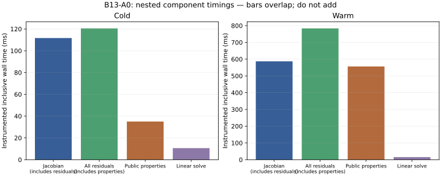

# Jacobian, Newton and TR-BDF2 cost

Original coupled state: ten refrigerant P/H coordinates used to solve conserved M/U/V balances, plus eleven thermal-energy increments. The accepted 21-coordinate formulation, signed finite differences, Newton tolerances and TR-BDF2 arithmetic remain unchanged. Neither thermal exact-column mode nor Jacobian reuse is enabled.

| Fixture | Trials | TR-BDF2 stages | Jacobians | Residual evaluations | Jacobian ms | All residual ms | Linear ms |
|---|---|---|---|---|---|---|---|
| cold | 51 | 102 | 235 | 5272 | 111.7 | 120.5 | 10.61 |
| warm | 153 | 306 | 867 | 19380 | 587.1 | 783.5 | 15.36 |

Each observed correction builds all 21 finite-difference columns and solves one 21×21 linear system. Derivative calls are exactly 21×235 = 4,935 cold and 21×867 = 18,207 warm. Residual counts close as initial-stage evaluations + 21 derivatives/correction + one accepted line-search evaluation/correction: 102 + 22×235 = 5,272; 306 + 22×867 = 19,380. This explains the measured workload without assuming a hidden linear-algebra bottleneck.

Jacobian timing includes residual and property time, but excludes the subsequent linear solve. It is about 61%/60% of observed advance wall; all residuals are about 66%/80%. Public property timing overlaps these scopes. The linear systems are about 6%/2%. Newton stage totals and complete nested scopes are in `analysis.json`; the rest includes recovery, adaptive error checks, commit/record work, diagnostics, allocation and runtime effects.

TR-BDF2 work multiplies nonlinear stages: every adaptive trial here completes six stages, including each of the rejected coarse/fine comparisons. Cold performs 102 stages for 16 accepted adaptive trials plus one rejected trial; warm performs 306 for 43 accepted trials plus eight rejected trials. These counts demonstrate the architectural expense of adaptive step doubling; they do not authorize replacing the integrator or error estimator.

A future equivalence study could separate object/array allocation from constitutive arithmetic in residuals, evaluate existing exact thermal columns under strict identity gates, and inspect vapor inverse repeat work. No speedup is promised until equivalent residuals, Jacobians, decisions and conservation are demonstrated. Faster linear algebra is a low-priority hypothesis on current evidence.
