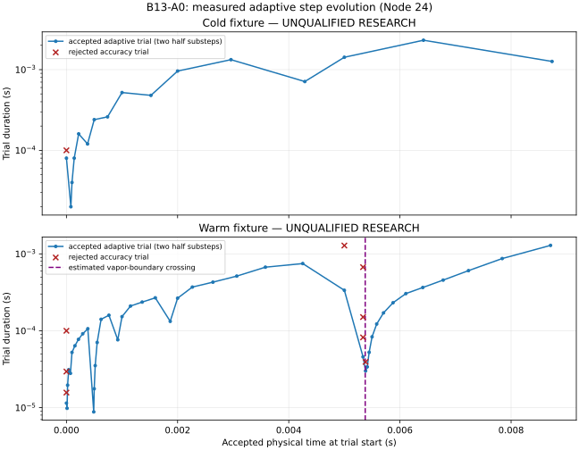

# Adaptive time steps and convergence

All times above 0.001 s are UNQUALIFIED RESEARCH. No longer-duration scientific qualification is claimed.

The original TR-BDF2 adaptive trial computes one coarse step and two half steps, each with two implicit stages. Accepted adaptive trials commit two physical substeps; attempted coarse states never become accepted states. Rejected trials consume all six stages here because rejection occurred after successful solves during temporal-error estimation.

| Fixture | Actual t (s) | Accepted substeps | Rejected trials | Residuals | Newton corrections / Jacobians | TR-BDF2 stages |
|---|---|---|---|---|---|---|
| cold | 0.01 | 32 | 1 | 5272 | 235 | 102 |
| warm | 0.01 | 86 | 8 | 19380 | 867 | 306 |

| Fixture | Attempted dt range (s) | Accepted physical half-step range (s) | Next proposed dt (s) |
|---|---|---|---|
| cold | 2e-05–0.00231317 | 1e-05–0.00115658 | 0.002527 |
| warm | 8.81139e-06–0.00129065 | 4.4057e-06–0.000645326 | 0.001494 |

Cold rejects its initial 0.0001 s trial at normalized temporal error 1.1122, then completes with no further rejection. Warm rejects initial trials at errors 23.9649, 4.0542 and 1.58075. Near the subsequent vapor crossing, errors reach 54.4708 and require additional subdivision. The smallest warm trial is an output-boundary remainder; minimum dt alone is not evidence of physical stiffness. The final physical state is supported and has no stop.

Newton corrections per stage:

| Fixture | Corrections : stage count |
|---|---|
| cold | {'2': 79, '3': 19, '5': 4} |
| warm | {'2': 107, '3': 159, '4': 29, '5': 7, '6': 3, '7': 1} |

Every recorded derivative is used at shrink 0 and positive sign; signed fallback capability remains unchanged but is not exercised by these normal-fixture runs. All recorded line searches accept factor 1. No Newton iteration-budget exhaustion, line-search refusal, branch-rejected derivative or failed constitutive probe occurs. Warm has more stages/iterations and expensive vapor PH inversions, not a demonstrated nonlinear failure ceiling.

Original controller proposal is `dt * clamp(0.85 * error^(-1/3), 0.1, accepted ? 2 : 0.8)`, capped at maxStep and output/event boundaries; zero error proposes factor 2. Failure-aware nonlinear history is unchanged and records zero nonlinear failures. Warm phase crossing resets growth history once. `state.trace`, `rejectionTrace`, `growthHistory` and per-attempt diagnostics retain every observed proposal input and retry. The next attempted duration, target remainder and nextStepSeconds distinguish growth from output clipping.

The event timestamp is a linear interpolation inside a committed bracket, not a precisely root-solved physical transition. No event causes an invented equipment alarm. Detailed interval tables are in `evidence/analysis.json` and SOLVER_PERFORMANCE_RESULTS.md.
