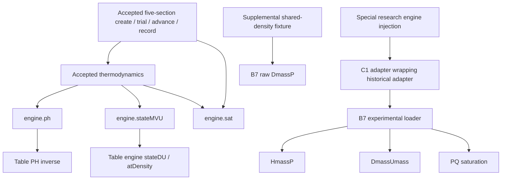

# Accepted A2 property call graph

The accepted model is Git `be9eb35a4ddf5098e685182f8104685127c6a6ee`, with the twelve exact snapshots in `../browser_eos_backend/accepted/`. The root `engine.js` and `properties.json` are also byte-identical to that commit. `evidence/start-audit.json` verifies these fourteen identities against Git, not just a report hash. Root `coupled-model.cjs` and `coupled-implicit.cjs` contain later research changes and are **not** used for this graph or trace. Accepted A2 has five sections and no initialProfile interface; the later nine-section/profile implementation is not borrowed.

Locations below are relative to `experiments/dx-fv/`, except `engine.js`. `A/` abbreviates `browser_eos_backend/accepted/`; `C1/` abbreviates `browser_eos_b5b_c1/`. A line number identifies a real function/edge, not a fixture-derived architectural assumption. The machine-readable import closure and hashes are in `evidence/a2-trace-summary.json` (`files`, `edges`).

The research engine injection is an alternative argument to the existing factory, not an installed production backend or an edge from the baseline table engine to CoolProp. There is no edge from current A2 or either adapter to raw DP.

| Stage | Actual call edges and source locations | Required property work |
|---|---|---|
| Factory / initialization | `A/coupled-model.cjs:64 createCoupledModel` → `A/thermodynamics.cjs:3 createThermodynamics`; `create:103` → schedule validation `patchSpec:91` and `thermo.ph`; `create:127` → `thermo.initialize:12` → `ph:4` → `engine.ph`, `engine.sat`; `A/conservation.cjs:3 inventory` | PH plus saturation; exact `M=rho*V`, `U=M*h−100*p*V` in kg/kJ/bar arithmetic. Five `V=.003/5` inventories. Boundaries PH-validated at `create:128`. No DP state constructor. |
| Initial canonical verification | `create:130` → `recover:81` → `A/thermodynamics.cjs:13 recover` → `engine.stateMVU` → `engine.sat(recovered.p)` | Required even before the first timestep; original M/U/V and pressure guess passed unchanged. |
| Trial start / coordinates | `trial:193` → `coordinates:80` → `thermo.ph(pGuess,(U+100*pGuess*V)/M)`; `trial:196` → recover each cell | Both PH coordinates and canonical DU-equivalent recovery are required; pressure guess is not conserved pressure or a support certificate. |
| Rate evaluation | `evaluate:137` → inlet/outlet `thermo.ph`; section states passed from the solve; `connectionFlow` in `A/hydraulics.cjs:2`; `A/conservation.cjs:7 flux` | Hydraulics uses p/rho and signed donor h; tube heat uses section T at `evaluate:146`. No additional inverse pair. Flow reversal selects donor, not a new flash pair. |
| Newton residual | `solveStage:157` → `A/coupled-implicit.cjs:7 coupledNewton` → residual closure `solveStage:170` → `thermo.ph` at `:173`, exact-pair local cache → inventory, thermal rates and mass/energy residuals | PH required throughout solve. Cache does not reuse a different PH pair or a different stage. Getters are fields of completed PH states. |
| Signed Jacobian probes | `A/coupled-implicit.cjs:38` epsilon; `:43` twelve shrink attempts; `:44` signs +1/−1; `:48` evaluate(probe); `:49` region comparison; `:65` last-cause refusal | PH probes, including pressure/enthalpy trials and branch changes. DU is **not** called inside this residual/probe evaluation. Thermal FD columns also evaluate this closure; exact thermal columns are separately opt-in. |
| Newton line search | `A/coupled-implicit.cjs:71` factors 1 through 2^-28 → evaluate(nextX) | PH trial evaluations. Original line search remembers last domain cause; C1 additionally preserves property cause, without changing steps/residuals. |
| Post-Newton scientific cross-check | `solveStage:185` → recover every solved inventory; `:188` compare recovered PH/T with stage PH | Required canonical stateMVU/DU operation after convergence. A DU error can reject a converged Newton stage; it does not itself constitute a signed PH derivative failure. |
| TR-BDF2 / adaptive stepping | `trial:203` initial rate; `:204` gamma substep; `:205` final stage; `advance:275` coarse trial; `:277` two half trials; `errorEstimate:208` / `Time.estimate:209` → Time.estimate and PH coordinates | Same PH, MVU and saturation dependencies recur. No DP/PS/PU shortcut. Accepted values are two unextrapolated half steps. |
| Phase events | `advance:280` and `commit:214` → `A/time-control.cjs:23 crossings` → `engine.sat` at before/after p; signed h−hf and h−hg margins | Saturation required on ordinary paths, event tests and detached commit preparation. Phase enum alone does not define the crossing. |
| Boundary edits / scheduled events | `update:333` / `advance:267` → `applyBoundary:226` → `patchSpec:91` → PH validation before spec replacement | PH required on boundary changes, not only initial startup. No arbitrary M/U/V patch or density/pressure initialization interface. |
| Numerical failure / floor evidence | `advance:283` catch → dt/2 `:293` → floor `:294` → `domainEvidence:232`; `:250` PH-coordinate rate reevaluation; `:256` directional perturbed conserved inventory → recover | Error-only PH/MVU/saturation dependencies. Accepted original code may infer a refrigerant domain stop from untyped domain recovery. C1 typed failures explicitly prevent this unsupported inference. Thermal boundary recheck `:237` remains independent. |
| Rollback / accepted install | `advance:318` detached ledger/events; `:319` commits; `:320` installs only after both commits prepared | All trials and failed preparation leave physical accepted values intact. Work counters, failure metadata and stop are bookkeeping. No invalid raw state is installed by refusal. |
| Record / final outlet | `record:334` → sections.map(recover); `:343` evaluate PH rates and coordinates; terminal uses last recovered section; `:345` outlet PH at imposed outlet pressure using signed donor enthalpy | MVU, PH and saturation are required after integration too. A failed section reconstruction throws; outlet-only PH failure is caught and marked unsupported. C1 retains structured diagnostics. |
| Wet-suction indication | `A/thermodynamics.cjs:10,15` computes wet from x<1 or liquid phase and superheat from T−Tsat; `record:343` exposes terminal/outlet | No separate compressor model, protected dry-suction selector, PS compressor solve or controller is called. Root engine exports `solve`/`ps`, but this dependency closure never calls them. A2's outlet flag is a bulk port diagnostic, not proof against liquid carryover. |

## Backend implementation edges

Baseline `engine.js:76 stateMVU` → lexical `stateDU:52` with `rho=M/V`, `u=U/M` in kJ/kg. `stateDU` evaluates lexical `atDensity(p,rho):40`, then obtains `u=h−100*p/rho`. It scans/brackets pressure and uses table saturation, `statePX:18` or `statePT:14`/branch interpolation. Its internal density-at-pressure evaluation has DP-like coordinates, but it **does not call CoolProp**, the B7 loader or `DmassP_INPUTS`. This distinction follows the full engine source, not the name of a fixture. `engine.js:19 inverse` underlies exported PH/PS; PH is required, PS is not called by A2. Nested lexical engine calls do not pass through the observation proxy.

Experimental `browser_eos_backend/adapter.mjs:23 stateMVU` divides M/V and U/M, multiplies kJ/kg by 1000, and calls `eos.evaluate({mode:'DU'})`. `ph:22` calls PH with bar→Pa and kJ→J conversion. `sat:7` calls SAT. `convert:13` applies the original table PH guard, saturation support and temperature envelope; it does not request DP. `C1/adapter.mjs:14 createAdapter` wraps exactly these methods. C1 changes error meaning/transport, not property values or equations.

`browser_eos_b7/loader.mjs:84` maps SAT to `PQ_INPUTS(p,0)` and endpoint keyed getters; the high-level alternative uses PropsSI P,Q=0/1. `:97` maps PH→HmassP with reversed argument order and DU→DmassUmass. It also exposes DP→DmassP, PS/PU/DH/DS/DT/QT to **explicit raw callers**. Public SAT therefore requires PQ under the low-level browser configuration, but the simulator never separately requests an arbitrary PQ state. Underlying DU may internally use saturation/QT; a strict QT failure can block DU even though A2 never explicitly calls QT.

B7's `runtime-environment.mjs` appends the existing `COOLPROP_ENABLE_SUPERANCILLARIES=false` environment setting only for its isolated full-VLE instance. The default is superancillary. `activation-chromium.json` / `activation-webkit.json` retain logging-on/off parity and actual config=0 / HSU_D_flash / saturation_D activation; source/artifact hashes are retained by Gate 0. No configuration selection is inferred from a fixture name.

| Pair / operation | Classification in current A2 |
|---|---|
| PH | Required normal trajectory, initialization, FD/line search, boundary edits, recording and some error evidence |
| M/U/V → DU-equivalent table recovery | Required initialization, normal canonical checks, record; also error-direction reconstruction |
| Raw CoolProp DU | Invoked only with special experimental engine argument; full-VLE branch requires further explicit configuration |
| SAT(P) | Required normal and event/error paths; table interpolation baseline, PQ/endpoint getters in experimental loader |
| DP raw CoolProp | Diagnostic-only, no implemented adapter/model edge |
| Internal table atDensity(p,rho) | Required inside table DU inversion; distinct table code, no dependency on failed raw CoolProp DP |
| PS / PU / DH / DS | Raw supplemental diagnostic interfaces; no current accepted model invocation |
| PT / DT / QT | Raw diagnostic interfaces; QT may be an internal EOS step behind conditional DU, not an A2 caller pair |
| Compressor PS solve / arbitrary DP initialization | Not implemented in accepted five-section model; no current planned-feature runtime dependency is inferred |
| Exact transient occurrence of four DU inventories / inward hazards | UNKNOWN; saved constructions/property replay do not prove a natural trajectory |

## Bounded runtime verification

`trace-a2.cjs` verifies file hashes against the independently Git-checked starting audit, then loads the exact preserved snapshots. It runs the original cold five-section fixture with nonzero tube/refrigerant conductance and open flow for **0.001 s**, original default numerical values plus existing trace/failure-aware options. Runtime: Node **24.19.0**. This is observation evidence, not a replacement for historical Node 22 qualification.

Public engine calls: **11,086 PH**, **11,876 saturation**, **470 stateMVU**. The existing solver observer recorded **3,675 derivative events**, **175 line-search events**, and ten attempts. Exact accepted states, initial/final records and all decisions compare equal with and without the proxy/observer. All invoked public engine methods are enumerated by the proxy; no DP operation occurs. Records include exact argument bits and call stacks. The compressed full trace is `evidence/a2-trace.json.gz`; its digests, closure, final record and counts are in `a2-trace-summary.json`.

This small trajectory does not exercise every branch/event. The complete static closure establishes DP exclusion, while source tracing and saved C1 coverage cover the unexercised failure paths. No endpoint substitute, fault injection, extra property evaluation, numerical source transformation or full qualification campaign is used in this trace. The separate saved-row adapter replay is explicitly synthetic and proves classification only.
